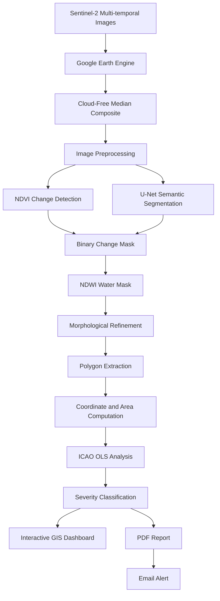
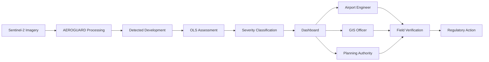

<p align="center">
  
</p>

<h1 align="center">🛰️ AEROGUARD</h1>

<h3 align="center">
AI-Powered Satellite Change Detection Framework for Airport Obstacle Limitation Surface (OLS) Encroachment Monitoring
</h3>

<p align="center">
An intelligent geospatial decision-support framework that combines satellite remote sensing, explainable AI, deep learning, GIS analytics, and aviation safety regulations to automatically identify potential airport OLS encroachments.
</p>

---

<p align="center">


</p>

<p align="center">


</p>


---

# Overview

**AEROGUARD** is an AI-assisted geospatial monitoring framework designed to support **airport safeguarding** by automatically identifying potential Obstacle Limitation Surface (OLS) encroachments from multi-temporal satellite imagery.

The framework integrates **Google Earth Engine**, **Sentinel-2 satellite imagery**, **NDVI-based change detection**, **deep learning (U-Net)**, **geospatial polygon analysis**, and an **ICAO Annex 14–inspired OLS assessment model** to transform raw Earth observation data into actionable airport safety intelligence.

Given a pair of satellite images from two different time periods, AEROGUARD detects newly developed built-up regions, evaluates their proximity to protected airport airspace, prioritizes operational risk, and prepares visual reports and alert notifications for further review — turning what is normally a manual, periodic inspection task into a fast, repeatable, on-demand analysis.

> **Mission:** Enable scalable, data-driven, and intelligent monitoring of airport surroundings to support proactive identification of potential OLS encroachments and assist airport authorities in prioritizing areas for investigation.

---

<p align="center">
📍 <b>Developed for Neo-Nexus 36.1 National Level Hackathon</b><br>
<b>Problem Statement:</b> AERO-03 – Satellite Change Detection System for Airport OLS Zone Encroachment Monitoring
</p>

---

# 🌍 The Real-World Problem

Modern airports are surrounded by rapidly expanding cities. As urban development accelerates, new residential buildings, commercial complexes, communication towers, mobile masts, water tanks, cranes, industrial facilities, and other vertical structures are continuously constructed near airport boundaries.

While these developments support economic growth, they can also introduce potential obstacles within the protected airspace required for safe aircraft operations.

To safeguard aircraft during take-off, landing, and missed-approach procedures, the **International Civil Aviation Organization (ICAO)** defines a set of protected three-dimensional airspace surfaces known as **Obstacle Limitation Surfaces (OLS)** under **ICAO Annex 14**. These surfaces establish the maximum permissible height of structures surrounding an airport to ensure obstacle-free flight paths. In India, the **Airports Authority of India (AAI)** enforces these limits under the *Aircraft (Demolition of Obstructions caused by Buildings and Trees, etc.) Rules, 1994*.

Any structure that penetrates these protected surfaces may require detailed aeronautical assessment and enforcement action by airport authorities.

<p align="center">

<br>
<em>Figure 1. Conceptual representation of ICAO Obstacle Limitation Surfaces surrounding an airport.</em>
</p>

---

# ✈️ Why Airport Safeguarding Matters

Airport safeguarding is not limited to the runway itself. The surrounding airspace forms an integral part of airport infrastructure and directly influences operational safety.

Even a single newly constructed structure can potentially affect:

- Aircraft take-off paths
- Landing approach procedures
- Missed approach operations
- Navigation aid protection
- Future airport expansion
- Obstacle clearance requirements

As metropolitan regions continue to expand, monitoring these developments becomes increasingly challenging for airport authorities.

---

# 🚨 A Growing, Documented Operational Challenge

This is not a hypothetical problem. Recent, publicly documented cases confirm the scale of OLS violations across Indian airports:

### Surat Airport (2025)
The **Airports Authority of India (AAI)** formally identified **28 multi-storey buildings** near Surat airport that breach Obstacle Limitation Surface criteria. The Ministry of Civil Aviation confirmed in a written Rajya Sabha response that both DGCA and AAI issued formal demolition notices under the Aircraft (Demolition of Obstructions) Rules, 1994.
*Source: The Tribune, "28 high-rise structures near Surat airport breach aviation safety norms: Centre"*

### Delhi Airport
Delhi International Airport (P) Limited (DIAL) informed the **Delhi High Court** that **365 obstacles** around the airport posed a potential safety threat to aircraft, prompting judicial directions to compile a full obstruction list and enforcement plan.
*Source: Hindustan Times / Delhi High Court proceedings*

### The pattern
Both cases share a common thread: obstacles were identified only *after* formal survey or litigation — not through continuous, automated monitoring. By the time such reviews are completed, encroaching structures are often already fully built, making remediation far more costly and disruptive than early detection would have been.

Traditionally, airport obstacle monitoring relies on a combination of periodic obstacle surveys, manual interpretation of satellite imagery, GIS-based inspections, field verification, and coordination across multiple government agencies. These practices are effective but resource-intensive, and do not scale efficiently against the pace of urban development around airports.

This highlights the need for intelligent systems capable of analyzing satellite imagery on demand and automatically flagging areas that warrant further investigation — well before formal surveys or legal proceedings are required to catch the problem.

---

# ❓ The Key Challenge

The challenge is **not simply detecting land-use change.**

The real challenge is determining:

> **Has new infrastructure been developed within or near protected airport airspace, and should airport authorities investigate it?**

Answering this question requires more than conventional image comparison. It requires integrating Satellite Remote Sensing, Artificial Intelligence, Geospatial Analytics, Aviation Regulations, and Risk Assessment into a single decision-support framework.

---

# 🤖 Why Automation Helps

With thousands of square kilometres surrounding major airports and continuous infrastructure development occurring throughout the year, manual monitoring alone is difficult to sustain at scale.

An automated framework can assist airport authorities by:

✅ Analyzing multi-temporal satellite imagery on demand
✅ Identifying newly developed built-up regions
✅ Extracting precise geographic coordinates
✅ Estimating affected area
✅ Evaluating proximity to protected OLS zones
✅ Prioritizing potential risks by severity
✅ Generating standardized reports
✅ Preparing rapid notifications for further investigation

Rather than replacing existing airport safeguarding procedures, such a system serves as an intelligent decision-support tool that helps authorities focus limited inspection resources on the locations that merit closer examination first.

---

# 💡 Motivation Behind AEROGUARD

AEROGUARD was developed to bridge the gap between **Earth Observation**, **Artificial Intelligence**, and **Aviation Safety**.

Instead of requiring engineers to manually inspect large volumes of satellite imagery, the framework transforms multi-temporal Earth observation data into actionable geospatial intelligence — demonstrated end-to-end on Kempegowda International Airport (VOBL), Bengaluru.

> **From pixels to protection — transforming satellite imagery into actionable airport safety intelligence.**

---

# 🎯 Project Objectives

- Analyze airport surroundings using multi-temporal satellite imagery.
- Detect newly developed built-up areas through explainable and AI-assisted change detection techniques.
- Convert raster detections into georeferenced polygons with spatial attributes.
- Evaluate detected developments against ICAO Annex 14–inspired Obstacle Limitation Surface (OLS) zones.
- Classify each detected region according to its potential operational significance.
- Provide intuitive visualizations for rapid interpretation.
- Generate standardized PDF reports for documentation.
- Prepare automated email notifications for critical detections requiring further review.

---

# 🚀 Technical Contributions

### 🌍 Earth Observation
- Multi-temporal Sentinel-2 satellite imagery
- Google Earth Engine cloud-based processing
- Cloud-free median composite generation

### 🌱 Explainable Remote Sensing
- NDVI-based change detection
- Percentile threshold segmentation
- Morphological refinement
- NDWI-based water masking

### 🤖 Artificial Intelligence
- U-Net semantic segmentation, trained from scratch on LEVIR-CD
- Deep learning comparison against classical image differencing
- Tile-based inference for high-resolution satellite imagery
- Domain-gap evaluation on real-world airport imagery

### 🗺️ Geospatial Intelligence
- Raster-to-vector polygon conversion
- Coordinate extraction
- Area computation (UTM-projected for accuracy)
- Spatial overlay analysis
- Interactive GIS visualization

### ✈️ Aviation Safety Analytics
ICAO Annex 14–inspired:
- Horizontal Surface
- Conical Surface
- Approach Surface

Spatial analysis determines whether newly detected developments intersect protected airport airspace.

### 📊 Decision Support
- Interactive web-based GIS maps
- Geospatial change polygons
- Severity assessment
- Downloadable PDF reports
- Automated email alerting for critical observations

---

# ✨ Innovation Highlights

✅ Integration of remote sensing, AI, GIS, and aviation regulations in one pipeline
✅ Hybrid explainable (NDVI) and deep learning (U-Net) analysis, cross-validated
✅ Automated raster-to-vector geospatial intelligence generation
✅ ICAO-inspired OLS compliance assessment, built from real runway geometry
✅ Severity-based prioritization of detected developments
✅ Interactive visualization for rapid interpretation
✅ Automated report generation
✅ Automated notification workflow for critical OLS observations

---

# 🏆 Why AEROGUARD is Different

| Conventional Monitoring | AEROGUARD |
|--------------------------|-----------|
| Periodic field/legal-driven surveys (e.g. Surat, Delhi cases) | On-demand automated satellite analysis |
| Manual GIS interpretation | AI-assisted geospatial analysis |
| Human interpretation of imagery | Automated dual-method change detection |
| Manual obstacle mapping | Automatic polygon generation with coordinates |
| Separate GIS analysis | Integrated OLS assessment |
| Manual report preparation | Automatic PDF generation |
| Delayed communication | Automated email notification workflow |
| Reactive (often litigation-driven) | Proactive decision-support |

---

# 🌐 End-to-End Operational Workflow

```
Satellite Acquisition
        ↓
Cloud-Free Processing
        ↓
Change Detection (NDVI + U-Net)
        ↓
Water Masking
        ↓
Polygon Generation
        ↓
Spatial Analytics
        ↓
OLS Assessment
        ↓
Severity Classification
        ↓
Visualization
        ↓
Report Generation
        ↓
Notification Workflow
```

---

# 🏗️ System Architecture

AEROGUARD follows a modular, layered architecture that progressively transforms raw multi-temporal satellite imagery into actionable airport safety intelligence.



## Layer 1 — Earth Observation
Sentinel-2 MSI imagery via Google Earth Engine, filtered to a region of interest around the airport, composited into cloud-free mosaics for both time periods.

## Layer 2 — Intelligent Change Detection
**Explainable pipeline (primary):** NDVI computation → difference image → percentile thresholding → morphological filtering → NDWI water masking. Fast, interpretable, requires no training.

**AI pipeline (comparative):** U-Net encoder-decoder segmentation, trained on LEVIR-CD, tiled inference for full-resolution prediction. Demonstrates deep learning feasibility while transparently documenting the domain-gap challenge of applying a Texas-trained model to Bengaluru imagery.

## Layer 3 — Geospatial Intelligence
Raster-to-vector conversion, noise filtering, coordinate extraction, and UTM-projected area estimation — turning pixel masks into meaningful geographic entities.

## Layer 4 — Aviation Safety Assessment
The core innovation: every detected polygon is spatially intersected with modeled Horizontal, Conical, and Approach surfaces (ICAO Annex 14–inspired, built from VOBL's actual runway coordinates since official AAI GIS data is not publicly available).

## Layer 5 — Decision Support
Interactive dashboard, severity-coded visualization, downloadable PDF report, and automated email alerts for Critical findings.

---

# 🧩 Modular Components

| Module | Responsibility |
|---------|----------------|
| Data Acquisition | Retrieve Sentinel-2 imagery |
| Preprocessing | Generate cloud-free composites |
| NDVI Engine | Explainable primary change detection |
| U-Net Engine | Deep learning comparative detection |
| Water Mask Engine | Eliminate water-related false positives |
| Polygon Engine | Convert raster outputs into GIS polygons |
| OLS Engine | Evaluate obstacle limitation surfaces |
| Risk Engine | Assign operational severity |
| Reporting Engine | Generate PDF reports |
| Notification Engine | Prepare automated alerts |

---

# ⚙️ Methodology & Key Engineering Decisions

| Stage | Decision | Rationale |
|-------|-----------|-----------|
| Imagery | Sentinel-2 via Earth Engine | Free, global, high revisit frequency, multispectral |
| Compositing | Median composite, not single scene | Removes cloud artefacts, improves temporal consistency |
| Primary detection | NDVI differencing | Explainable, fast, no training data required |
| Thresholding | Percentile-based, not Otsu | Otsu assumes bimodal separation, which our data lacked; percentile thresholding was far more stable |
| False-positive control | NDWI water masking | Seasonal water-level change was being misread as construction |
| Comparative detection | U-Net, trained on LEVIR-CD | Standard benchmark change-detection dataset; enables AI-based cross-validation |
| Inference | Tiled, full-resolution | Single-shot inference at low resolution blurred detail into generalized "developed area" blobs; tiling recovered spatial precision |
| OLS geometry | Built from ICAO Annex 14 rules + VOBL runway coordinates | Official AAI GIS boundary shapefiles are not publicly available; this is a transparent, documented approximation |
| Severity | Area + OLS zone type | Approach-surface intersections escalate to Critical regardless of size, since location matters more than area for flight safety |

### On the U-Net domain gap
Although U-Net achieved strong segmentation performance on its LEVIR-CD validation split (F1 ≈ 0.83, IoU ≈ 0.71), direct application to Sentinel-2 imagery over Bengaluru showed a real, expected domain gap versus the NDVI method — broader, less precise detections, consistent with transferring a model trained on US suburban imagery to a different geography. This is documented transparently rather than concealed, and is a clear direction for future fine-tuning on India-specific labeled imagery.

---

# 📊 Results & Evaluation

Study area: **Kempegowda International Airport (VOBL), Bengaluru** — Sentinel-2 imagery compared across 2019 vs 2025/26.

| Metric | Value |
|--------|-------|
| Total change polygons detected (NDVI) | 301 |
| Critical alerts (Approach Surface) | 13 |
| High severity (Horizontal Surface) | 90 |
| Total affected area | ~906,694 sqm |
| U-Net polygons detected (cross-validation) | 199 |

### U-Net quantitative validation (held-out LEVIR-CD validation set, 2,048 unseen image pairs)

| Metric | Score |
|--------|-------|
| Precision | 0.888 |
| Recall | 0.780 |
| F1 Score | 0.830 |
| IoU | 0.710 |
| Pixel Accuracy | 0.987 |

The model favors precision over recall — fewer false alarms, at the cost of occasionally missing subtler changes. A reasonable trade-off for an alerting system, where false positives carry a real cost in reviewer time.

### NDVI qualitative validation
Since no hand-labeled ground truth exists for Bengaluru, 15 randomly sampled detections were manually cross-checked against satellite imagery: **11/15 (73%) showed clearly visible built structures**, and the remaining 4/15 showed bare/cleared land consistent with early-stage construction activity. No confirmed false positives (water, shadow, sensor artifacts) were found in the sample.

---

# 🌐 System Outputs

### Interactive GIS Dashboard
Satellite basemap, OLS zone overlay, severity-coded change polygons, filterable alert table, before/after comparison view, and a live email-alert form — built with Streamlit.

### Automated PDF Report
Executive summary, severity breakdown table, full change-detection map, and a coordinate table of all Critical/High priority alerts.

### Automated Email Notification
Triggered for Critical findings, with the PDF report attached and a summary of affected coordinates in the message body.

---

# 🏢 Potential Operational Workflow



Rather than replacing existing airport safeguarding procedures, AEROGUARD serves as an intelligent decision-support layer that helps engineers and authorities prioritize locations requiring further investigation — ideally catching cases like Surat or Delhi earlier, before formal survey or litigation becomes necessary.

---

# 🌍 Practical Applications

- ✈️ Airport safeguarding and OLS monitoring
- 🏗️ Unauthorized construction detection
- 🌆 Urban expansion analysis
- 🛰️ Infrastructure development monitoring
- 🌍 Smart city planning
- 🚧 Large-scale construction surveillance
- 🛫 Airport master planning support
- 📊 Long-term geospatial change analysis

---

# 📂 Repository Structure

```text
AEROGUARD/
│
├── assets/
│   ├── banner.png
│   ├── architecture.png
│   ├── before_after.png
│   ├── ndvi_result.png
│   ├── ndwi_result.png
│   ├── unet_result.png
│   ├── polygon_result.png
│   ├── ols_overlay.png
│   ├── dashboard.png
│   ├── report_preview.png
│   └── email_alert.png
│
├── notebooks/
│   ├── AERO3_NDVI_pipeline.ipynb
│   └── AERO3_UNet_experiment.ipynb
│
├── app.py
│
├── outputs/
│   ├── ndvi_change_polygons.geojson
│   ├── unet_change_polygons.geojson
│   ├── ols_zones.geojson
│   ├── priority_alerts.csv
│   └── OLS_Alert_Report.pdf
│
├── README.md
├── requirements.txt
└── LICENSE
```

> 📌 Note: replace the `assets/` placeholders with real exported screenshots from your notebooks/dashboard before submission — the file names above match what your pipeline already produces.

---

# 💻 Technology Stack

| Category | Technologies |
|-----------|--------------|
| Programming | Python |
| Satellite Processing | Google Earth Engine, Sentinel-2 MSI |
| Remote Sensing | NDVI, NDWI |
| Deep Learning | PyTorch, U-Net |
| Image Processing | OpenCV, NumPy |
| Geospatial Analysis | GeoPandas, Rasterio, Shapely |
| Mapping | Folium, streamlit-folium |
| Dashboard | Streamlit |
| Reporting | ReportLab |
| Alerting | smtplib (Gmail SMTP) |
| Data Handling | Pandas |

---

# 🚀 Installation & Running

```bash
git clone https://github.com/<username>/AEROGUARD.git
cd AEROGUARD
pip install -r requirements.txt
```

Run the notebooks (`notebooks/AERO3_NDVI_pipeline.ipynb`, then `AERO3_UNet_experiment.ipynb`) in Google Colab or Jupyter to reproduce the analysis, or launch the live dashboard directly:

```bash
streamlit run app.py
```

---

# 🌍 Future Scope

- Near real-time satellite monitoring using high-frequency imagery (moving beyond the current on-demand snapshot comparison)
- Integration of Sentinel-1 SAR data for all-weather monitoring
- LiDAR-based height estimation for more accurate obstacle assessment
- Machine learning–based risk prediction for future urban expansion
- Fine-tuning U-Net on labeled Indian satellite imagery to close the current domain gap
- Integration with official AAI GIS databases if/when made publicly available
- Support for multiple airports through a centralized, configurable monitoring platform
- Cloud-native deployment for continuous nationwide monitoring

---

# 📖 References

- ICAO Annex 14 — Aerodrome Design and Operations
- Airports Authority of India, Survey & Cartography Manual (Aerodrome Survey Manual V1.02)
- Aircraft (Demolition of Obstructions caused by Buildings and Trees, etc.) Rules, 1994
- "28 high-rise structures near Surat airport breach aviation safety norms: Centre," The Tribune
- Delhi International Airport (P) Limited obstacle disclosure, Delhi High Court proceedings, reported by Hindustan Times
- Sentinel-2 MSI Documentation, European Space Agency
- Google Earth Engine Documentation
- LEVIR-CD Change Detection Dataset
- Ronneberger et al., "U-Net: Convolutional Networks for Biomedical Image Segmentation" (adapted here for remote sensing)

---

# 🤝 Acknowledgements

- Neo-Nexus 36.1 National Level Hackathon
- Google Earth Engine
- European Space Agency (ESA) / Sentinel-2 Mission
- Airports Authority of India (AAI)
- International Civil Aviation Organization (ICAO)
- OpenStreetMap Contributors
- PyTorch, GeoPandas, Rasterio, and Folium open-source communities

---

# 📜 License

Released under the **MIT License**. You are welcome to use, modify, and extend this work for research and educational purposes with appropriate attribution.

---

# 👨‍💻 Authors

**Akilan S U** — B.Tech. Computer Science & Engineering (AI & ML), Central University of Karnataka
**Ajay Vedharathinum K** — Project Collaborator, AK LABS

> ⚠️ Confirm these details match your official registration before final submission.

---

<div align="center">

# 🛰️ AEROGUARD
### From Satellite Pixels to Aviation Safety Intelligence

**Developed by AK LABS**

</div>
